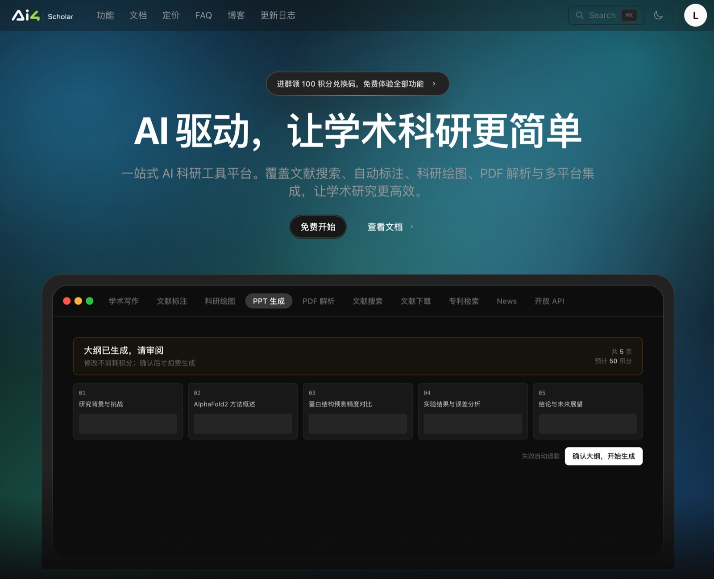
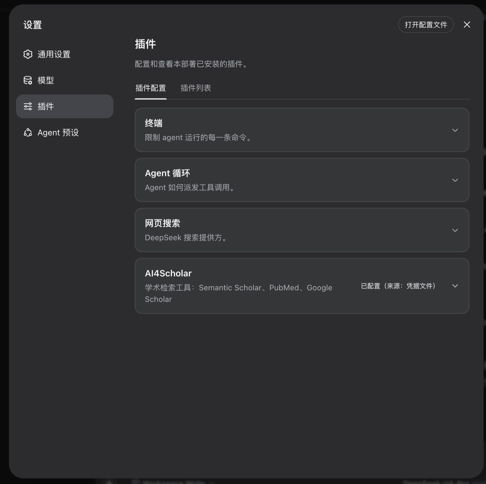
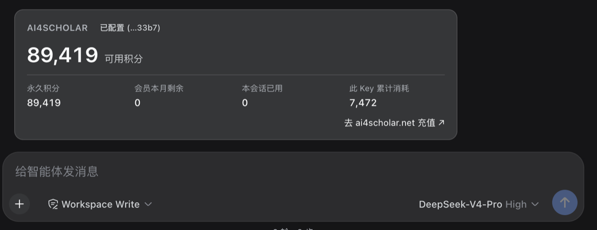

<p align="center"><a href="https://ai4scholar.net?src=dsh"></a></p>
<p align="center"><strong>dsh-ai4scholar</strong></p>

# AI4Scholar for DeepSeek Harness

English | [中文](README_CN.md)

[](https://www.npmjs.com/package/dsh-ai4scholar) [](https://github.com/literaf/dsh-ai4scholar/actions/workflows/ci.yml) [](https://github.com/topics/dsh-plugin) 

<p align="center"><a href="https://ai4scholar.net?src=dsh"></a></p>

Academic literature tools for [DeepSeek Harness](https://github.com/deepseek-ai/deepseek-harness) (`dsh`), delivered as 43 native agent tools. Powered by [ai4scholar.net](https://ai4scholar.net?src=dsh).

## Slash commands with natural-language requests

Choose a capability with a slash command, then describe the request normally. Unspecified criteria inherit the plugin settings.

| Command | Purpose |
|---|---|
| `/ai4s` | Key status, balance, default sources/counts, and command index |
| `/ai4s-search` | Unified paper search; request multiple sources and deduplication in plain language |
| `/ai4s-google` | Google Scholar papers |
| `/ai4s-semantic` | Semantic Scholar search, bulk collection, and full-text snippets |
| `/ai4s-snippets` | Search matching passages in Semantic Scholar indexed full texts |
| `/ai4s-pubmed` | PubMed biomedical literature |
| `/ai4s-arxiv` | arXiv preprints |
| `/ai4s-chinese` | Chinese journals, theses, and conference literature |
| `/ai4s-biorxiv`, `/ai4s-medrxiv` | Browse preprints by category and time window |
| `/ai4s-patents` | Google Patents search |
| `/ai4s-author` | Author discovery, profiles, publications, and comparisons |
| `/ai4s-paper` | Details, title matching, batches, full text, PDF links, citations, references, recommendations, and citation formats |
| `/ai4s-references` | Outgoing references: papers this paper cites (Semantic Scholar) |
| `/ai4s-citations` | Incoming citations: papers that cite this paper |
| `/ai4s-related` | Related papers and single/multiple-seed recommendations |
| `/ai4s-read` | Read full text, including requested character slices |
| `/ai4s-pdf` | Obtain a PDF URL; this does not save a local file |
| `/ai4s-export` | Citation formats and BibTeX/export links for a known paper (Google Scholar) |
| `/ai4s-cite` | Add real references to prose |
| `/ai4s-draw` | Generate, edit, style, compose, iterate, critique, SVG, and vectorize scientific figures |

There are 20 research commands plus `/ai4s` for account status, with `/ai4scholar` retained as an alias. Operation shortcuts disappear when their primary capability is disabled; lookup helpers alone do not keep them visible. Source and operation constraints are checked during tool execution. Snippets return excerpts, references are outgoing, citations are incoming, export formats an existing paper, and cite inserts references into prose.

```text
/ai4s-google 10 solid-state battery papers published since 2022
/ai4s-search Search Google Scholar and Semantic Scholar for solid-state batteries and merge duplicates
/ai4s-author Use Semantic Scholar to find Geoffrey Hinton; confirm the author’s identity before showing the profile and representative papers
/ai4s-read Read the third paper above, focusing on its methodology
/ai4s-snippets Find 5 passages describing solid-state battery interface resistance experiments
/ai4s-references List the references cited by the first paper
/ai4s-citations Find papers citing the first paper
/ai4s-export Get the APA reference and BibTeX link for the first paper
/ai4s-patents Find CATL’s solid-state battery patent applications in China from the last five years
```

An empty command shows an example without searching. Research commands queue a normal model turn in the current conversation: your configured model interprets the request, briefly states the source and material criteria, then calls tools. Results remain available for follow-ups. Conflicting sources and ambiguous authors require clarification; source-specific commands enforce the selected source at execution and leave global defaults unchanged. `/ai4scholar` remains an alias for the status command.

On current Harness, paper, author, and patent result cards offer applicable actions. Buttons prepare an editable natural-language follow-up containing the exact identifiers; they preserve existing composer drafts. PDF/source links open directly. Older clients without the tool-view slot retain ordinary tool results.

Google Scholar results retain native paper, cited-by, and version identifiers. Citation-format lookup requires the native paper ID, not a DOI, URL, or author-page citationId. Author search defaults to Semantic Scholar; explicitly requesting Google Scholar selects its author tools. Google’s available article list is not guaranteed complete and supplies no h-index. bioRxiv/medRxiv browse by category and time, not free-text keywords. Patents stay separate from unified paper search.

| Family | Tools | Cost |
|---|---|---|
| **Paper search** | `search_papers` — Semantic Scholar only by default; select PubMed, arXiv, Google Scholar, or Chinese literature via `sources` as needed. Multiple sources are merged by DOI / arXiv id / PMID / title, with multi-platform hits ranked first | per selected platform |
| **Semantic Scholar** (200M+ papers, all fields) | `search_semantic`, `search_semantic_bulk`, `search_semantic_snippets` (full-text excerpts), `search_semantic_paper_match` (title → paper), `get_semantic_paper_detail`, `get_semantic_paper_batch`, `get_semantic_citations`, `get_semantic_references`, `get_semantic_paper_authors`, `search_semantic_authors`, `get_semantic_author_detail`, `get_semantic_author_batch`, `get_semantic_author_papers`, `get_semantic_recommendations`, `get_semantic_recommendations_for_paper`, `download_semantic`, `read_semantic_paper` | credits |
| **PubMed** (biomedical & life sciences) | `search_pubmed`, `get_pubmed_paper_detail`, `get_pubmed_paper_batch`, `get_pubmed_citations`, `get_pubmed_related` | credits |
| **Chinese literature** (journals, theses, conferences; metadata and available abstracts) | `search_chinese` | credits |
| **Google Scholar** (papers, authors, reference formats) | `search_google_scholar`, `search_google_scholar_profiles`, `get_google_scholar_author`, `get_google_scholar_citation` | credits |
| **Google Patents** | `search_google_patents` | credits |
| **arXiv** | `search_arxiv`, `download_arxiv`, `read_arxiv_paper` | free |
| **bioRxiv / medRxiv** | `search_biorxiv`, `search_medrxiv`, `download_biorxiv`, `download_medrxiv`, `read_biorxiv_paper`, `read_medrxiv_paper` | free |
| **Any DOI** | `download_by_doi`, `read_by_doi` (open access anywhere; paywalled publishers on institutional networks) | free |
| **Writing & figures** | `auto_cite` (insert real citations + reference list + BibTeX), `sci_draw` (generate / edit / style / compose / critique / SVG / vectorize scientific figures) | credits |
| **Account** | `get_ai4scholar_credits`, plus the `/ai4scholar` slash command | free |

**Start with one source.** With the shipped settings, omitting `sources` (or passing `[]`) queries only Semantic Scholar. If you choose other default platforms on the plugin page, the same call searches those platforms together. For biomedical or clinical topics, select `sources: ["pubmed"]` as appropriate. Use multiple sources, such as `["semantic-scholar", "pubmed"]`, when broader coverage is explicitly requested or one source is insufficient. Each billed API request adds to the charge; Google Scholar bills per page, while arXiv is free. If none of the configured default platforms is enabled, the default is the first enabled platform in this order: Semantic Scholar, PubMed, arXiv, Google Scholar, Chinese literature.

Every paper-list tool returns one normalized record shape — title, authors, year, venue, citation count, DOI/PMID/arXiv ids, URL, open-access PDF, abstract — so the model (and Code Mode programs) can chain calls across platforms without special cases. Results render as citation cards in the dsh Web UI; full-text tools return the PDF text in slices (`offset` / `max_chars`) so a 40-page paper never floods the context.

**Credits are visible.** Every billed tool card in the chat carries the charge in its title (`Semantic Scholar: protein folding · 10 credits · 4,990 left`), the model-facing result ends with `AI4Scholar credits — this call: 10 · this session: 40 · remaining: 4,960` (from the API's `X-Credits-*` headers) and the model is asked to close a billed turn with a one-line credit note; `/ai4scholar` renders a balance card (available credits, breakdown, membership, key status, session spend) and `get_ai4scholar_credits` gives the model the same numbers. Free platforms (arXiv, bioRxiv/medRxiv, DOI) carry no credit line.

**Chinese literature.** Use `search_chinese` for Chinese keywords, document types (`journal`, `thesis`, `conference`), year filters, sorting, and pagination. It is also `sources: ["chinese"]` in `search_papers`, and stays unchecked in the shipped defaults. For a bilingual search, pass e.g. `query: "bird migration"`, `chinese_query: "鸟类迁徙"`, and `sources: ["semantic-scholar", "chinese"]`. Results share DOI and normalized-title de-duplication; short Chinese titles need the same year and first author, and conflicting DOIs stay separate. Translated titles without a shared identifier may remain separate. Chinese results provide metadata and available abstracts, not full-text downloads.

## Screenshots

| API key card (legacy Settings view) | `/ai4scholar` balance card |
|---|---|
|  |  |

## Install

**Quick start** (macOS / Linux; Windows PowerShell is the same):

```sh
# 0. Prerequisites: Node.js ≥ 22.19 (or ≥ 24) and pnpm (dsh manages plugins with pnpm)
node -v
npm i -g pnpm                     # skip if you already have it

# 1. DeepSeek Harness
npm i -g @deepseek-ai/dsh
dsh --version

# 2. This plugin (into the web profile; use --profile headless for the CLI runner)
dsh plugin --profile web add dsh-ai4scholar

# 3. Start
dsh web                           # prints http://127.0.0.1:3080
```

Then, once, in the browser:

1. **Settings → Models** — paste your DeepSeek API key ([platform.deepseek.com](https://platform.deepseek.com)).
2. **Plugins → Installed → dsh-ai4scholar** (or **Settings → AI4Scholar**) — paste your AI4Scholar API key ([ai4scholar.net](https://ai4scholar.net?src=dsh)) and press **Save**. The card stores it in the dsh credentials store (`$DSH_HOME/.credentials.yaml`, mode 0600, the same place the Models page keeps provider keys), tests it at once (`✓ Key works · 89,419 credits available`), and it takes effect on the next tool call — no restart. **Refresh** re-checks any time. The saved key is masked by default, with **Key configured** on the right; click the eye to reveal or hide it. Hiding, leaving the page, or switching away from the window clears the revealed value.

On current DSH Desktop, click **dsh-ai4scholar** in the sidebar’s **Plugins → Installed** list: the key form is visible immediately on its detail page. **Settings → Built-in plugins** is a host inventory, so it no longer contains this form. Older Harness versions still offer the original **Settings → Plugins → AI4Scholar** card. Existing keys keep working; all entrances use the same credential reference.

Pick a workspace folder and ask away. Upgrades: `dsh plugin --profile web add dsh-ai4scholar@latest`, then restart `dsh web`.

Prefer files or CI? The plugin resolves the credential reference `AI4SCHOLAR_API_KEY`, so any of these also work (highest precedence first): `export AI4SCHOLAR_API_KEY=…` in the shell that launches dsh · a line in `$DSH_HOME/.credentials.yaml` · a line in the project or `$DSH_HOME/.env`. The card reports which layer is supplying the key and goes read-only when the environment does. Headless has no settings page, so use one of these there.

Releases are pushed to npmmirror right after publishing, so the default registry in China serves new versions within a minute as well.

Verify the layer without booting: `dsh --profile web --dump-config` prints a `# == dsh-ai4scholar` section.

Then just ask:

> Find recent papers on CRISPR base editing for sickle cell disease and compare their delivery methods.

> Search PubMed for GLP-1 receptor agonists and cardiovascular outcomes since 2022, sorted by date.

> Which paper is "Attention Is All You Need"? Give me its DOI and citation count.

## Configuration

### On the plugin page

Open **Plugins → AI4Scholar** (or **Settings → AI4Scholar**; both edit the same values). Under the API key:

- **Search**: tick the platforms `search_papers` queries when the model names none (Semantic Scholar only by default), and set each platform's result count. Semantic Scholar, PubMed, and Chinese literature return up to 100 per search, billed once each; arXiv returns up to 100 for free. Google Scholar returns 1–10 per call (one credit); the model follows nextOffset with the same result count for more. All sources support pagination through their standalone tools; every additional billed request costs credits. The count is also the default for that platform's own search tool.
- **Results**: abstract length shown to the model (0–5000 characters, default 600), full-text slice per `read_*` call (2,000–200,000, default 60,000), and whether results carry the credit line.
- **Citations and figures**: `auto_cite` reference style (IEEE by default) and whether to leave out preprints; `sci_draw` model (Flash 3.1 by default) and resolution (2K by default).

The model can still pass its own values for a single call. **Save** writes the changed fields into your profile's `cordis.patch.yml` and the plugin reloads with them. The next tool call and new conversations use the new values. **Restore defaults** removes them again. This page needs DeepSeek Harness 0.2.1 or later; on older versions it tells you to edit the file instead.

### In the profile file

The bundle mounts one row (`id: ai4scholar`) with these defaults. Override from your profile's `cordis.patch.yml` (a patch replaces the whole `config`, so restate every key you keep). For DeepSeek Harness Desktop the file is `~/.dsh/profiles/desktop/cordis.patch.yml` on macOS; for the CLI it is `$DSH_HOME/profiles/<profile>/cordis.patch.yml`:

```yaml
- id: ai4scholar
  config:
    apiKeyEnv: AI4SCHOLAR_API_KEY   # credential reference; the key itself never lives in config
    baseUrl: https://ai4scholar.net
    # tool families
    semanticScholar: true
    pubmed: true
    googleScholar: true
    googlePatents: true              # search_google_patents
    chineseLiterature: true
    arxiv: true
    biorxiv: true                    # bioRxiv + medRxiv
    doi: true
    fullText: true                   # the read_* tools (PDF download + text extraction)
    autoCite: true
    sciDraw: true
    creditsTool: true                # get_ai4scholar_credits
    command: true                    # the /ai4scholar slash command
    balanceRoute: true               # GET /ai4scholar/balance for the settings card's key test
    showCredits: true                # credit line on billed results (plugin page)
    promptGuidance: true             # short system-prompt section describing the tools
    promptOrder: 150
    # search_papers default platforms (plugin page); any of
    # semantic-scholar, pubmed, arxiv, google-scholar, chinese
    searchSources: [semantic-scholar]
    # per-platform result count (plugin page); a missing one uses defaultMaxResults
    resultsPerSource: {}             # e.g. { semantic-scholar: 100, google-scholar: 10 }
    citeStyle: ieee                  # auto_cite: ieee | apa | vancouver | nature | numbered (plugin page)
    citeExcludePreprints: false      # auto_cite (plugin page)
    drawModel: flash31               # sci_draw: flash | flash31 | pro | gptimage (plugin page)
    drawImageSize: 2K                # sci_draw: 1K | 2K | 4K (plugin page)
    # sizes
    defaultMaxResults: 10            # shared fallback count (configuration file)
    maxResultsCap: 100               # hard upper bound per call; each platform also caps
    abstractMaxChars: 600            # abstract characters shown per paper; 0 hides abstracts (plugin page)
    readMaxChars: 60000              # characters per full-text slice (plugin page)
    # timeouts / retry
    requestTimeoutMs: 30000          # per HTTP attempt
    pdfTimeoutMs: 120000             # per PDF download
    generationTimeoutMs: 300000      # auto_cite / sci_draw
    maxRetries: 3                    # attempts on 429 / network errors
    retryBackoffMs: 2000             # doubles per attempt
    toolTimeoutMs: 180000            # cooperative per-call budget enforced by dsh
```

The API key is resolved **per call** through `ctx.credentials`, so storing or rotating it takes effect on the next tool call without a restart. When the credentials service is absent (a custom composition), the plugin falls back to `process.env[apiKeyEnv]`.

The settings card always edits `AI4SCHOLAR_API_KEY` (the browser half does not receive the row config); a deployment that overrides `apiKeyEnv` manages that reference through the environment or the credentials file instead. The session credit tally is process-local (it restarts with dsh); the balance itself always comes from the API.

## How it fits dsh

- Two halves in one package: the Node half registers the tools; the browser half (`exports["./client"]`, declared by `dsh.client`) contributes the settings card through native `plugins.bundle.config` / `plugins.row.config` slots and `settings.section` (plus `settings.plugin.item` on older hosts) writes keys through the credentials API. An explicit reveal uses `POST /api/ai4scholar/key/reveal` on the host’s authenticated, owner-only channel with `Cache-Control: no-store`; it is not a model tool and does not add the key to model context. Older hosts without this protected channel cannot reveal saved keys.
- Tools are registered on `ctx.tools` with `defineTool`: typed, schema-validated arguments; a canonical JSON value per call (`{ source, query, total, papers[], truncated, nextOffset? }`); a Markdown rendering for the model; and a `web` result card (structured sources) for the Web UI.
- A single `tool:ai4scholar` system-prompt section tells the model when to use which platform and to cite by DOI/link.
- Everything is an effect: unloading the plugin (or editing its config, which triggers HMR) withdraws every tool and the prompt section.
- No model-visible input is added outside the tool results, so sessions stay fully replayable from the log.

## Development

```sh
pnpm install
pnpm test          # builds lib/ (Node half via tsc, browser bundle via tsdown), then runs:
                   #   unit tests, a smoke test against the real ToolRuntime, and a jsdom test that
                   #   loads the built client bundle under the dsh module-host contract and drives the card
pnpm typecheck

# try it in a dsh profile without publishing:
dsh plugin --profile web add /absolute/path/to/dsh-ai4scholar
```

`dsh plugin add github:<you>/dsh-ai4scholar` also works: the `prepare` script builds `lib/` from source, and pnpm asks you to allow it once via `allowBuilds` in the profile's `pnpm-workspace.yaml`.

## Notes

- `download_by_doi` / `read_by_doi` resolve through doi.org and known publisher PDF patterns (Elsevier, Springer/Nature, Wiley, T&F, MDPI, IEEE, ACM, ACS, RSC, PLOS, Frontiers, bioRxiv/medRxiv, arXiv). Paywalled articles only download when dsh runs on a network with institutional access; a refusal names the landing page so the user can fetch it by hand.
- Full-text extraction uses `pdf-parse` (pdf.js) in-process; scanned/image-only PDFs yield an explicit error rather than empty text.
- The same tool set ships for [OpenClaw](https://github.com/literaf/ai4scholar-plugin-openclaw), [Codex](https://github.com/literaf/ai4scholar-plugin-codex) and [Hermes](https://github.com/literaf/ai4scholar-plugin-hermes).

## License

MIT
