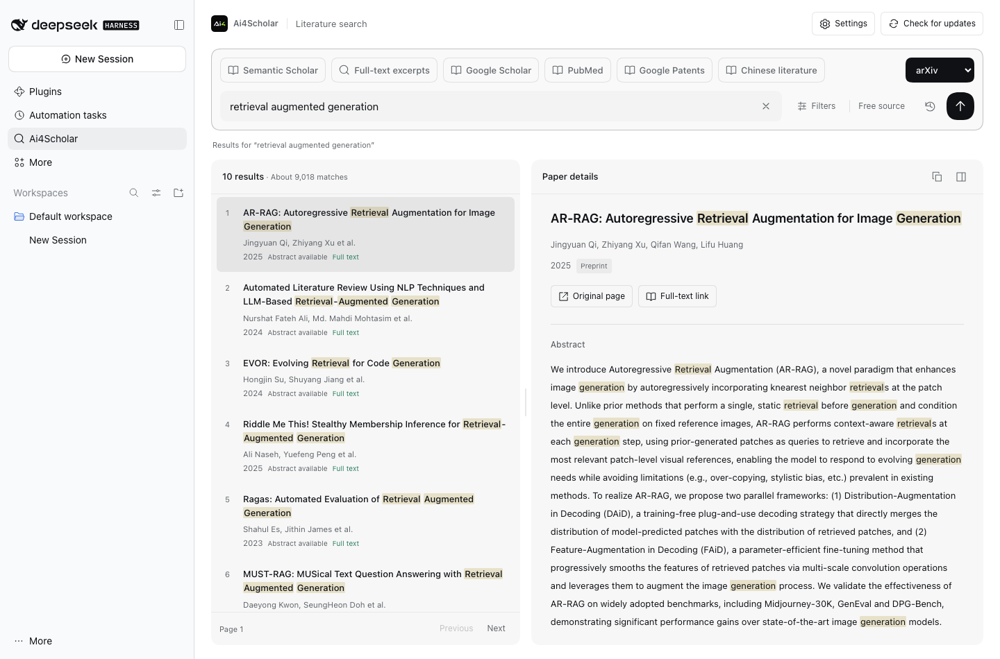
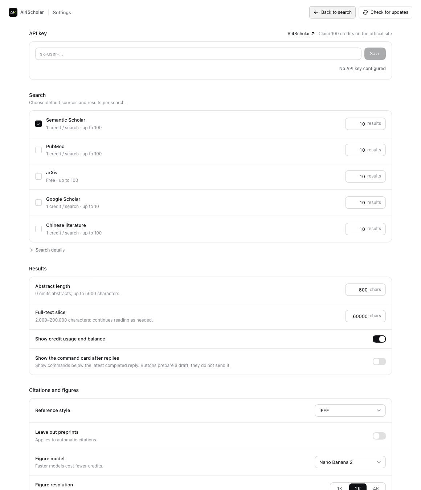
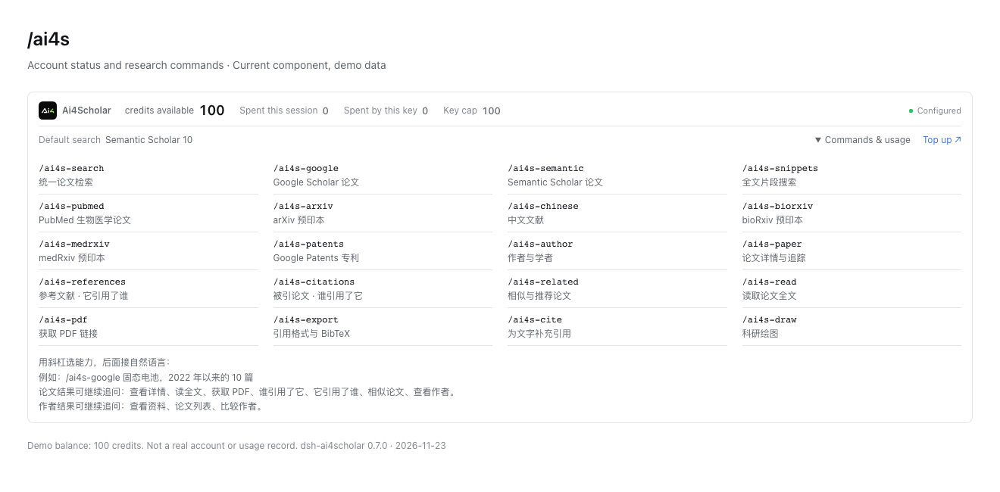
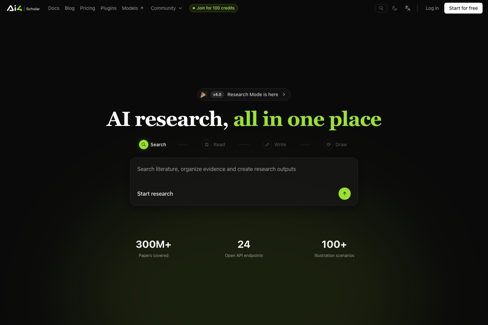

<p align="center"><a href="https://ai4scholar.net?src=dsh_ai4scholar"></a></p>

# AI4Scholar for DeepSeek Harness

English | [中文](README_CN.md)

[](https://www.npmjs.com/package/dsh-ai4scholar) [](https://github.com/literaf/dsh-ai4scholar/actions/workflows/ci.yml) [](https://github.com/topics/dsh-plugin) [](LICENSE)

**Search literature, read papers, follow citations, and create scientific figures inside DeepSeek Harness.** A sidebar workspace for direct searches, plus **43 native tools** for your chat model. Data services are provided by [ai4scholar.net](https://ai4scholar.net?src=dsh_ai4scholar).

[Install](#install-and-get-started) · [Slash commands](#slash-commands) · [Sources and costs](#sources-and-costs) · [Settings](#settings) · [Commercial licensing](COMMERCIAL-LICENSE.md)



*Captured on 2026-11-23 with plugin 0.7.0 and Harness 0.2.2-rc.5. These are real results from the free arXiv API; source results can change. [Screenshot details](docs/SCREENSHOTS.md).*

## What you can do

| Research task | Plugin capability |
|---|---|
| Find papers | Semantic Scholar, PubMed, Google Scholar, Chinese literature, and arXiv; request multiple sources in chat to search and deduplicate together |
| Read and follow evidence | Full-text excerpts, accessible PDF text in slices, paper and author details, references, incoming citations, and related papers |
| Find patents and preprints | Google Patents search; browse bioRxiv / medRxiv by subject and date window |
| Write and illustrate | Add references to prose, format known-paper citations, and generate or edit figures with Seedream 5.5, GPT Image, and Nano Banana models |
| Set your defaults | Shared API key, per-source result counts, abstract and full-text lengths, drawing defaults, and credit receipts |

## Two ways to work

**Search directly in the sidebar.** Open **Ai4Scholar**, choose a source, enter a topic, and search. Browse results beside the selected paper, read its abstract or matching excerpt, and open source/full-text links. The workspace does not call a chat model; arXiv, bioRxiv, and medRxiv also need no AI4Scholar API key. Filters depend on the source, with distinct detail views for patents and excerpts.

**Continue your research in chat.** Ask normally or choose a slash command below. Your model can chain searches, paper lookup, full-text reading, and citation follow-ups, keeping results in the conversation. Configure a chat model in Harness to use this workflow.

```text
/ai4s-search Search Google Scholar and Semantic Scholar for solid-state batteries and merge duplicates
/ai4s-read Read the third paper above, focusing on its methodology
/ai4s-citations Find papers citing the first paper
/ai4s-cite Add real references to this paragraph in APA style: …
/ai4s-draw Use Seedream 5.5 to draw a cell structure diagram with Chinese labels at 2K
```

## Install and get started

### DeepSeek Harness Desktop

1. Open **Plugins → Add plugin**, enter `dsh-ai4scholar`, install, and enable it.
2. Open **Ai4Scholar → Settings** in the sidebar. For billed sources, click **Get API key**, sign in to [AI4Scholar](https://ai4scholar.net?src=dsh_ai4scholar), and create a key in the Open Platform. Paste it into the settings field and save. It takes effect on the next tool call.
3. Return to the workspace, choose a source, and search. For natural-language research, configure a Harness chat model and send a request or an `/ai4s-*` command.

Workspace settings, the plugin detail page, and **Settings → AI4Scholar** share the same key and defaults. The current Desktop's built-in plugin inventory does not contain this plugin's settings form.

### Web / CLI

Requires Node.js **≥ 22.19.0** and pnpm:

```sh
npm i -g pnpm                   # skip if already installed
npm i -g @deepseek-ai/dsh
dsh plugin --profile web add dsh-ai4scholar
dsh web
```

Open the URL printed in your terminal and configure the plugin as above. For command-line tasks, install into `--profile headless` and set `AI4SCHOLAR_API_KEY` through the environment or Harness credentials store.

**Updates:** **Check for updates** in the workspace shows your version, the latest stable npm release, and release notes; it does not install automatically. Update a Desktop registry installation under **Plugins → dsh-ai4scholar → Version**. For Web, run `dsh plugin --profile web add dsh-ai4scholar@latest` and restart `dsh web`. Desktop manages its own installation; Web/CLI profile commands do not update it.

## Settings



*Captured from the current settings page with no real API key configured.*

- **Search:** unified search defaults to Semantic Scholar. Enable other default sources and set each source's result count. Calls inherit these settings when options are omitted.
- **Results:** abstracts default to 600 characters; full-text reading defaults to 60,000 characters per slice and can continue as needed. Credit display is configurable.
- **Command card:** optionally show the command menu after the latest completed reply. Off by default. Buttons prepare a draft; add your request and send it.
- **Citations and figures:** IEEE is the default citation style. Drawing defaults to Nano Banana 2 (`flash31`), 2K; Seedream 5.5, GPT Image, and other supported models are also available.
- **Key and saving:** the key is stored in Harness credentials and is not added to model context. It stays hidden until you explicitly reveal it. Saved defaults apply to subsequent calls.

## Slash commands

Choose a capability, then describe your request in natural language. The default catalog has **20 research commands plus one account command**. Disabling a capability hides its shortcut. `/ai4scholar` remains an alias for `/ai4s`.

| Command |Purpose |
|---|---|
| `/ai4s` | Key status, balance, default sources/counts, and command index |
| `/ai4s-search` | Unified paper search; request multiple sources and deduplication in plain language |
| `/ai4s-google` | Google Scholar papers |
| `/ai4s-semantic` | Semantic Scholar search, bulk collection, and full-text snippets |
| `/ai4s-snippets` | Search matching passages in Semantic Scholar indexed full texts |
| `/ai4s-pubmed` | PubMed biomedical literature |
| `/ai4s-arxiv` | arXiv preprints |
| `/ai4s-chinese` | Chinese journals, theses, and conference literature |
| `/ai4s-biorxiv`, `/ai4s-medrxiv` | Browse preprints by category and time window |
| `/ai4s-patents` | Google Patents search |
| `/ai4s-author` | Author discovery, profiles, publications, and comparisons |
| `/ai4s-paper` | Details, title matching, batches, full text, PDF links, citations, references, recommendations, and citation formats |
| `/ai4s-references` | Outgoing references: papers this paper cites (Semantic Scholar) |
| `/ai4s-citations` | Incoming citations: papers that cite this paper |
| `/ai4s-related` | Related papers and single/multiple-seed recommendations |
| `/ai4s-read` | Read full text, including requested character slices |
| `/ai4s-pdf` | Obtain a PDF URL; this does not save a local file |
| `/ai4s-export` | Citation formats and BibTeX/export links for a known paper (Google Scholar) |
| `/ai4s-cite` | Add real references to prose |
| `/ai4s-draw` | Generate, edit, restyle, compose, create SVG, and vectorize scientific figures |

An empty research command shows help without starting a search. Source-specific commands constrain that request without changing global defaults. For multi-source search, use `/ai4s-search` and name the sources.

Current Harness paper, author, and patent cards offer applicable follow-ups. Buttons prepare an editable request with exact identifiers and preserve existing drafts. Source and PDF links open directly.



*The image uses the current plugin's actual card component with local demonstration values, not a real account or charge. Command descriptions currently come from the plugin's Chinese command catalog.*

## Sources and costs

| Source / capability | AI4Scholar credits |
|---|---|
| Semantic Scholar, PubMed, Google Scholar, Google Patents, Chinese literature | Billed according to the called API |
| arXiv, bioRxiv, medRxiv | Free; no AI4Scholar key required |
| DOI resolution and accessible PDF reading | No plugin API-credit charge; access rights still depend on the source |
| Automatic citations and AI figures | Uses credits; image model, resolution, and quality can affect the cost |
| Balance lookup, command-menu display, update checks | No API-credit charge |

Multi-source search calls each selected source. New searches and new pages on billed sources incur their corresponding charges; actual API receipts determine credit usage. Your configured Harness model provider bills chat-model usage separately.

Workspace results and recent searches remain in the current client session. Revisiting loaded pages makes no new request; refreshing the page clears that in-memory history.

## Boundaries and related plugins

- **Abstracts, excerpts, and full text differ.** Chinese literature provides metadata and available abstracts. Excerpt search matches indexed titles, abstracts, or body passages. The `read_*` tools attempt to fetch accessible PDFs and extract their text; scanned/image-only PDFs cannot be extracted as ordinary text.
- **PDF commands return links.** `/ai4s-pdf` does not save a file to your computer. Paywalled papers still require institutional-network or other applicable access.
- **Citation direction and purpose matter.** References are outgoing; citations are incoming. Export formats a known paper; Cite adds references to prose. Google Scholar citation formats require the original paper ID returned by that source.
- **bioRxiv / medRxiv browse categories and time windows.** They are not keyword full-text searches. Patents are separate from unified paper search.
- **Scientific figures:** current operations are `smart / generate / edit / style / compose / svg / vectorize`. Seedream 5.5 supports 1K/2K and up to 10 reference images. GPT `quality` and Gemini `thinking_level` depend on the model; the API validates each combination.
- For a dedicated canvas, layer editing, and PSD export, install [PlotFig](https://ai4scholar.net/integrations/dsh-plotfig?src=dsh_ai4scholar). For saved HTML/CSV/JSON evidence reports, install [Fulltext](https://ai4scholar.net/integrations/dsh-fulltext?src=dsh_ai4scholar). These are separate plugins.

## AI4Scholar website

[Get an API key](https://ai4scholar.net?src=dsh_ai4scholar) · [Plugin guide](https://ai4scholar.net/integrations/dsh-ai4scholar?src=dsh_ai4scholar) · [Pricing](https://ai4scholar.net/pricing?src=dsh_ai4scholar)

[](https://ai4scholar.net?src=dsh_ai4scholar)

*Captured from the public website. The web workspace's full feature set is broader than this plugin's tools.*

## Tools and advanced configuration

<details>
<summary>All 43 native tools</summary>

| Family |Tools | Cost |
|---|---|---|
| **Paper search** | `search_papers` — Semantic Scholar only by default; select PubMed, arXiv, Google Scholar, or Chinese literature via `sources` as needed. Multiple sources are merged by DOI / arXiv id / PMID / title, with multi-platform hits ranked first | per selected platform |
| **Semantic Scholar** | `search_semantic`, `search_semantic_bulk`, `search_semantic_snippets` (full-text excerpts), `search_semantic_paper_match` (title → paper), `get_semantic_paper_detail`, `get_semantic_paper_batch`, `get_semantic_citations`, `get_semantic_references`, `get_semantic_paper_authors`, `search_semantic_authors`, `get_semantic_author_detail`, `get_semantic_author_batch`, `get_semantic_author_papers`, `get_semantic_recommendations`, `get_semantic_recommendations_for_paper`, `download_semantic`, `read_semantic_paper` | credits |
| **PubMed** (biomedical & life sciences) | `search_pubmed`, `get_pubmed_paper_detail`, `get_pubmed_paper_batch`, `get_pubmed_citations`, `get_pubmed_related` | credits |
| **Chinese literature** (journals, theses, conferences; metadata and available abstracts) | `search_chinese` | credits |
| **Google Scholar** (papers, authors, reference formats) | `search_google_scholar`, `search_google_scholar_profiles`, `get_google_scholar_author`, `get_google_scholar_citation` | credits |
| **Google Patents** | `search_google_patents` | credits |
| **arXiv** | `search_arxiv`, `download_arxiv`, `read_arxiv_paper` | free |
| **bioRxiv / medRxiv** | `search_biorxiv`, `search_medrxiv`, `download_biorxiv`, `download_medrxiv`, `read_biorxiv_paper`, `read_medrxiv_paper` | free |
| **Any DOI** | `download_by_doi`, `read_by_doi` (open access anywhere; paywalled publishers on institutional networks) | free |
| **Writing & figures** | `auto_cite` (insert real citations + reference list + BibTeX), `sci_draw` (generate / edit / style / compose / SVG / vectorize scientific figures) | credits |
| **Account** | `get_ai4scholar_credits`, plus the `/ai4scholar` slash command | free |

</details>

<details>
<summary>Configure defaults and credentials in a profile file</summary>

The bundle mounts one row (`id: ai4scholar`) with these defaults. Override from your profile's `cordis.patch.yml` (a patch replaces the whole `config`, so restate every key you keep). For DeepSeek Harness Desktop the file is `~/.dsh/profiles/desktop/cordis.patch.yml` on macOS; for the CLI it is `$DSH_HOME/profiles/<profile>/cordis.patch.yml`:

```yaml
- id: ai4scholar
  config:
    apiKeyEnv: AI4SCHOLAR_API_KEY   # credential reference; the key itself never lives in config
    baseUrl: https://ai4scholar.net
    # tool families
    semanticScholar: true
    pubmed: true
    googleScholar: true
    googlePatents: true              # search_google_patents
    chineseLiterature: true
    arxiv: true
    biorxiv: true                    # bioRxiv + medRxiv
    doi: true
    fullText: true                   # the read_* tools (PDF download + text extraction)
    autoCite: true
    sciDraw: true
    creditsTool: true                # get_ai4scholar_credits
    command: true                    # the /ai4scholar slash command
    balanceRoute: true               # GET /ai4scholar/balance for the settings card's key test
    showCredits: true                # credit line on billed results (plugin page)
    showCommandCard: false           # opt-in command menu after the latest reply (plugin page)
    promptGuidance: true             # short system-prompt section describing the tools
    promptOrder: 150
    # search_papers default platforms (plugin page); any of
    # semantic-scholar, pubmed, arxiv, google-scholar, chinese
    searchSources: [semantic-scholar]
    # per-platform result count (plugin page); a missing one uses defaultMaxResults
    resultsPerSource: {}             # e.g. { semantic-scholar: 100, google-scholar: 10 }
    citeStyle: ieee                  # auto_cite: ieee | apa | vancouver | nature | numbered (plugin page)
    citeExcludePreprints: false      # auto_cite (plugin page)
    drawModel: flash31               # sci_draw: flash | flash31 | pro | gptimage | gpt26flare | gpt26sunburst | banana21 | bananalite | seedream55 (plugin page)
    drawImageSize: 2K                # sci_draw: 1K | 2K | 4K (plugin page)
    # sizes
    defaultMaxResults: 10            # shared fallback count (configuration file)
    maxResultsCap: 100               # hard upper bound per call; each platform also caps
    abstractMaxChars: 600            # abstract characters shown per paper; 0 hides abstracts (plugin page)
    readMaxChars: 60000              # characters per full-text slice (plugin page)
    # timeouts / retry
    requestTimeoutMs: 30000          # per HTTP attempt
    pdfTimeoutMs: 120000             # per PDF download
    generationTimeoutMs: 300000      # auto_cite / sci_draw
    maxRetries: 3                    # attempts on 429 / network errors
    retryBackoffMs: 2000             # doubles per attempt
    toolTimeoutMs: 180000            # cooperative per-call budget enforced by dsh
```

The API key is resolved **per call** through `ctx.credentials`, so storing or rotating it takes effect on the next tool call without a restart. When the credentials service is absent (a custom composition), the plugin falls back to `process.env[apiKeyEnv]`.

The settings card always edits `AI4SCHOLAR_API_KEY` (the browser half does not receive the row config); a deployment that overrides `apiKeyEnv` manages that reference through the environment or the credentials file instead. The session credit tally is process-local (it restarts with dsh); the balance itself always comes from the API.

</details>

## Development

For version numbers, test packages, and release checks, follow the [release policy](RELEASING.md) (Chinese). Routine development changes do not require a version bump.

```sh
pnpm install
pnpm test          # builds lib/ (Node half via tsc, browser bundle via tsdown), then runs:
                   #   unit tests, a smoke test against the real ToolRuntime, and a jsdom test that
                   #   loads the built client bundle under the dsh module-host contract and drives the card
pnpm typecheck

# try it in a dsh profile without publishing:
dsh plugin --profile web add /absolute/path/to/dsh-ai4scholar
```

`dsh plugin add github:<you>/dsh-ai4scholar` also works: the `prepare` script builds `lib/` from source, and pnpm asks you to allow it once via `allowBuilds` in the profile's `pnpm-workspace.yaml`.

## License

Starting with **0.7.0**, this plugin's AI4Scholar-authored code uses [AGPL-3.0-only](LICENSE). **Commercial use is allowed under AGPL**; a separate written [commercial license](COMMERCIAL-LICENSE.md) is available for other terms covering rights AI4Scholar owns.

Earlier releases through **0.6.6** keep their original MIT grants. Third-party licenses remain applicable. See [licensing details](LICENSING.md), [third-party notices](THIRD_PARTY_NOTICES.md) and [corresponding source](SOURCE.md).
