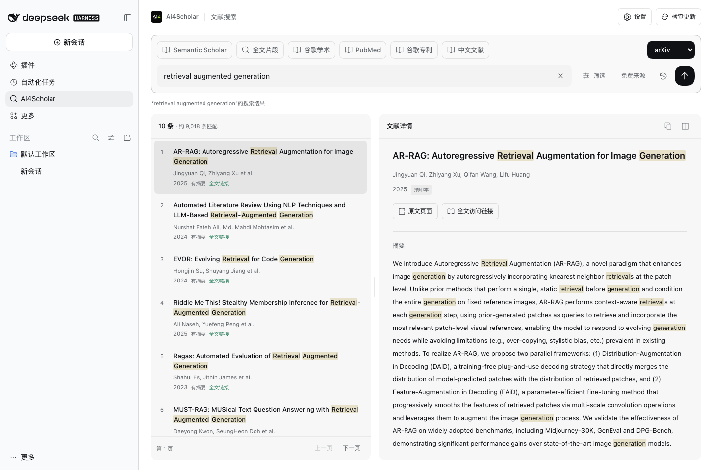
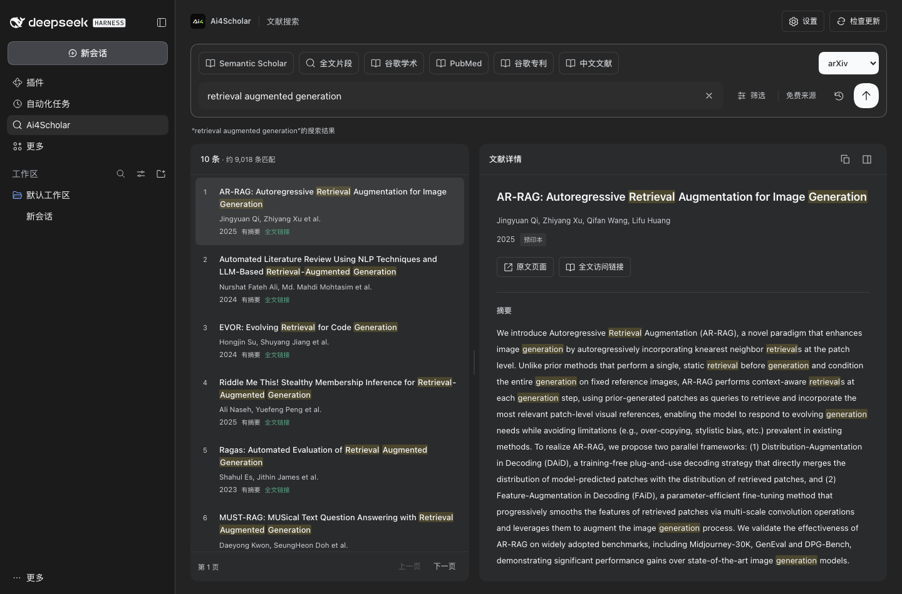
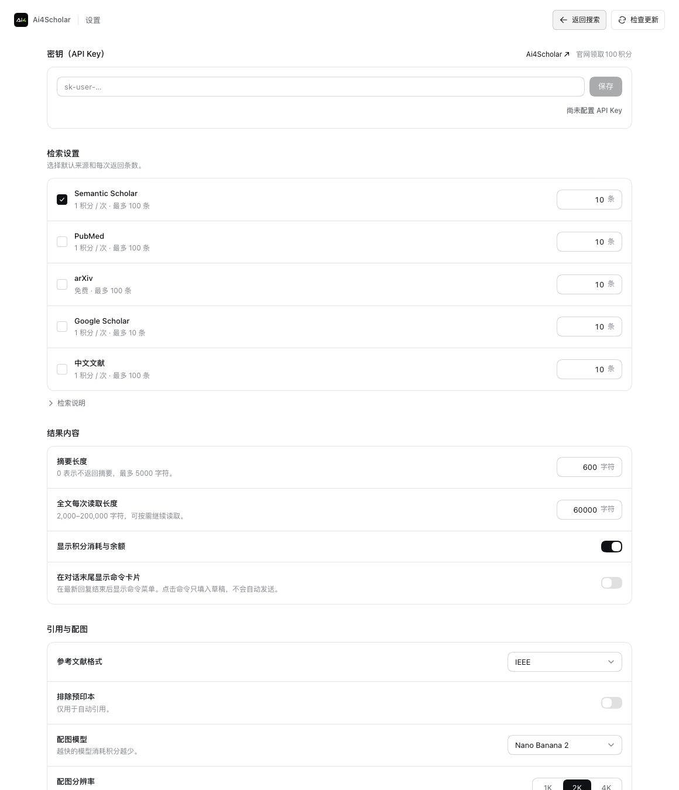
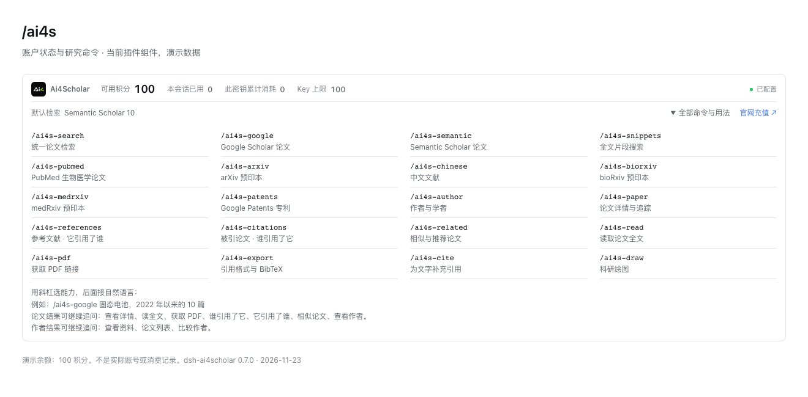

<p align="center"><a href="https://ai4scholar.net?src=dsh_ai4scholar"></a></p>

# AI4Scholar × DeepSeek Harness

[English](README.md) | 中文

[](https://www.npmjs.com/package/dsh-ai4scholar) [](https://github.com/literaf/dsh-ai4scholar/actions/workflows/ci.yml) [](https://github.com/topics/dsh-plugin) [](LICENSE)

**在 DeepSeek Harness 中检索文献、阅读论文、追踪引用和制作科研配图。** 一个可直接使用的侧栏工作台，加上供聊天模型调用的 **43 个原生工具**。数据服务由 [ai4scholar.net](https://ai4scholar.net?src=dsh_ai4scholar) 提供。

[安装](#安装与开始使用) · [斜杠命令](#斜杠命令) · [来源与费用](#来源与费用) · [设置](#设置) · [商业授权](COMMERCIAL-LICENSE.md)



*插件 0.7.0、Harness 0.2.2-rc.5，2026-11-23 实拍。上图使用免费 arXiv 接口的真实返回结果；结果会随来源更新。[截图来源说明](docs/SCREENSHOTS.md)。*

## 能做什么

| 研究任务 | 插件能力 |
|---|---|
| 查文献 | Semantic Scholar、PubMed、Google Scholar、中文文献与 arXiv；在聊天中指定多个来源时，可统一搜索并去重 |
| 找证据、追踪论文 | 全文片段、可访问 PDF 的分段读取、论文与作者详情、参考文献、被引论文和相关推荐 |
| 查专利与预印本 | Google Patents 专利检索；按学科和时间浏览 bioRxiv / medRxiv |
| 写作与配图 | 为文字补引用、获取已有论文的引用格式；调用 Seedream 5.5、GPT Image、Nano Banana 系列模型生成或处理科研图 |
| 管理默认选项 | 共用 API Key、各来源返回条数、摘要与全文长度、绘图默认模型、积分消耗与余额 |

## 两种使用方式

**在侧栏直接检索。** 打开 **Ai4Scholar**，选择来源、输入主题并搜索，左侧看结果，右侧读摘要或匹配片段、打开原文和全文链接。工作台不调用聊天模型；arXiv、bioRxiv、medRxiv 也无需 AI4Scholar API Key。筛选条件按来源提供，专利和全文片段有各自的详情展示。

**在聊天中继续研究。** 直接提问，或用下面的斜杠命令选择能力。模型可以把搜索、论文定位、全文阅读、引用追踪等工具串起来，结果留在当前对话中供后续追问。聊天方式需要先在 Harness 配置模型。

```text
/ai4s-search 同时用 Google Scholar 和 Semantic Scholar 查固态电池，合并去重
/ai4s-read 读刚才第三篇的全文，重点解释研究方法
/ai4s-citations 查哪些论文引用了刚才第一篇
/ai4s-cite 为这段文字补充真实参考文献，采用 APA 格式：……
/ai4s-draw 用 Seedream 5.5 画一张带中文标注的细胞结构图，2K
```

<details>
<summary>查看深色工作台</summary>



</details>

## 安装与开始使用

### DeepSeek Harness Desktop

1. 在 **插件 → 添加插件** 中输入 `dsh-ai4scholar`，安装并启用。
2. 打开侧栏 **Ai4Scholar → 设置**。使用收费来源时，粘贴从 [AI4Scholar](https://ai4scholar.net?src=dsh_ai4scholar) 获取的 API Key 并保存；密钥在下一次工具调用即生效。
3. 返回工作台选择来源开始检索。需要自然语言研究时，再配置 Harness 的聊天模型，在对话中输入需求或 `/ai4s-*` 命令。

工作台设置、插件详情页和 **设置 → AI4Scholar** 共用密钥与默认选项。当前 Desktop 的内置插件清单不承载本插件的设置表单。

### Web / 命令行

需要 Node.js **≥ 22.19.0** 和 pnpm：

```sh
npm i -g pnpm                   # 已安装则跳过
npm i -g @deepseek-ai/dsh
dsh plugin --profile web add dsh-ai4scholar
dsh web
```

浏览器打开终端打印的地址，后续设置与上面相同。命令行任务可把安装目标换成 `--profile headless`，并通过 `AI4SCHOLAR_API_KEY` 环境变量或 Harness 凭据存储配置密钥。

**更新：** 工作台右上角的 **检查更新** 显示当前版本、npm 最新正式版和发布说明，不会自动安装。Desktop 从 **插件 → dsh-ai4scholar → 版本** 更新注册表安装；Web 运行 `dsh plugin --profile web add dsh-ai4scholar@latest` 后重启 `dsh web`。Desktop 自行管理安装，Web/CLI 的 profile 操作不会替它更新。

## 设置



*实拍当前设置页，未配置任何真实密钥。*

- **检索设置：** 统一检索默认只查 Semantic Scholar，可勾选其他来源，并分别设置每个来源的返回条数。单次未指定条件时继承这些设置。
- **结果内容：** 摘要长度默认为 600 字符；全文分段默认每次 60,000 字符，可按需继续读取；可控制是否显示积分信息。
- **命令卡片：** 可在最新回复结束后显示命令菜单，默认关闭。点击命令只填写草稿，补充需求后再发送。
- **引用与配图：** 自动引用默认 IEEE；配图默认 Nano Banana 2（`flash31`）、2K。也可选择 Seedream 5.5、GPT Image 和其他受支持模型。
- **密钥与保存：** 密钥存入 Harness 的凭据存储，不加入模型上下文；默认隐藏，主动点击眼睛才显示。保存默认选项后，后续调用采用新设置。

## 斜杠命令

选择能力后直接接自然语言。默认提供 **20 个研究命令＋1 个状态命令**；关闭某项能力后，对应入口会隐藏。`/ai4scholar` 继续作为 `/ai4s` 的兼容别名。

| 命令 |用途 |
|---|---|
| `/ai4s` | 密钥状态、余额、默认来源和条数、功能索引 |
| `/ai4s-search` | 统一论文检索，可用自然语言临时指定多个来源并去重 |
| `/ai4s-google` | Google Scholar 论文检索 |
| `/ai4s-semantic` | Semantic Scholar 检索、批量收集和全文片段 |
| `/ai4s-snippets` | 在 Semantic Scholar 索引的全文中查找匹配片段 |
| `/ai4s-pubmed` | PubMed 生物医学论文 |
| `/ai4s-arxiv` | arXiv 预印本 |
| `/ai4s-chinese` | 中文期刊、学位论文和会议文献 |
| `/ai4s-biorxiv`、`/ai4s-medrxiv` | 按分类、时间浏览预印本 |
| `/ai4s-patents` | Google Patents 专利检索 |
| `/ai4s-author` | 找学者、看资料、论文列表和作者比较 |
| `/ai4s-paper` | 论文详情、标题匹配、批量详情、全文、PDF、被引、参考文献、相关推荐和引用格式 |
| `/ai4s-references` | 参考文献：这篇论文引用了谁（Semantic Scholar） |
| `/ai4s-citations` | 被引论文：谁引用了这篇论文 |
| `/ai4s-related` | 相似与推荐论文，支持多篇种子论文 |
| `/ai4s-read` | 读取论文全文，可按字符范围分段 |
| `/ai4s-pdf` | 获取 PDF 链接，不等于保存本地文件 |
| `/ai4s-export` | 获取已知论文的引用格式和 BibTeX 等导出链接（Google Scholar） |
| `/ai4s-cite` | 为一段文字补充真实引用 |
| `/ai4s-draw` | 科研绘图、编辑、风格转换、多图合成、SVG 与矢量化 |

空的研究命令显示用法，不发起检索。来源专用命令会约束本次调用的来源，不改全局默认设置。需要多平台搜索时使用 `/ai4s-search` 并明确列出来源。

当前 Harness 的论文、作者和专利结果卡片提供适用的后续操作。按钮会把带准确标识的请求填入草稿，不覆盖已有草稿；原文和 PDF 链接直接打开。



*上图使用当前插件的真实卡片组件和本地演示余额，用于展示布局；不代表真实账号或实际消费。*

## 来源与费用

| 来源 / 能力 | AI4Scholar 积分 |
|---|---|
| Semantic Scholar、PubMed、Google Scholar、Google Patents、中文文献 | 按所调用的 API 计费 |
| arXiv、bioRxiv、medRxiv | 免费，无需 AI4Scholar Key |
| DOI 解析与可访问 PDF 的读取 | 本插件不收 API 积分；访问权限仍由文献来源决定 |
| 自动引用、AI 科研配图 | 消耗积分；绘图模型、分辨率和质量会影响费用 |
| 查询余额、显示命令菜单、检查更新 | 不收 API 积分 |

多平台检索会分别请求所选来源；收费来源的新搜索和新分页会产生相应费用。积分记录以 API 实际回执为准。聊天模型的用量由 Harness 中配置的模型服务另行计费。

工作台结果和最近搜索仅保留在当前客户端会话内。回看已经加载的分页不重复请求；刷新页面后需要重新搜索。

## 使用边界与相关插件

- **摘要、全文片段和整篇全文不同。** 中文文献返回题录与可用摘要；全文片段来自索引中的标题、摘要或正文；`read_*` 才会尝试获取可访问 PDF 并抽取全文。扫描版或纯图片 PDF 无法直接按文本抽取。
- **PDF 命令返回链接。** `/ai4s-pdf` 不等于把文件保存到电脑。付费文章仍需要机构网络或相应访问权限。
- **引用的方向与用途不同。** References 是“它引用了谁”，Citations 是“谁引用了它”；Export 获取已有论文的引用格式，Cite 为一段文字补引用。Google Scholar 引用格式需要该来源返回的原始论文 ID。
- **bioRxiv / medRxiv 按分类与时间浏览。** 不应当作关键词全文搜索；专利结果也不混入统一论文检索。
- **科研绘图：** 当前操作为 `smart / generate / edit / style / compose / svg / vectorize`。Seedream 5.5 支持 1K/2K、最多 10 张参考图；GPT 的 `quality` 与 Gemini 的 `thinking_level` 按模型使用。具体组合由 API 校验。
- 需要独立画布、图层编辑与 PSD 导出，可另装 [PlotFig](https://ai4scholar.net/integrations/dsh-plotfig?src=dsh_ai4scholar)；需要保存为 HTML/CSV/JSON 的全文摘录报告，可另装 [Fulltext](https://ai4scholar.net/integrations/dsh-fulltext?src=dsh_ai4scholar)。这两个插件独立安装。

## AI4Scholar 网站

[获取 API Key](https://ai4scholar.net?src=dsh_ai4scholar) · [插件安装指南](https://ai4scholar.net/integrations/dsh-ai4scholar?src=dsh_ai4scholar) · [定价](https://ai4scholar.net/pricing?src=dsh_ai4scholar)

[](https://ai4scholar.net?src=dsh_ai4scholar)

*网站公开首页实拍；网页工作区的全部功能不等于本插件提供的工具范围。*

## 工具与高级配置

<details>
<summary>展开全部 43 个原生工具</summary>

| 家族 |工具 | 计费 |
|---|---|---|
| **论文检索** | `search_papers`——默认只查 Semantic Scholar；通过 `sources` 按需选择 PubMed、arXiv、Google Scholar、中文文献。多平台结果按 DOI / arXiv id / PMID / 标题去重合并，同时命中的排前面 | 按所选平台计 |
| **Semantic Scholar** | `search_semantic`、`search_semantic_bulk`、`search_semantic_snippets`（全文片段）、`search_semantic_paper_match`（标题→论文）、`get_semantic_paper_detail`、`get_semantic_paper_batch`、`get_semantic_citations`、`get_semantic_references`、`get_semantic_paper_authors`、`search_semantic_authors`、`get_semantic_author_detail`、`get_semantic_author_batch`、`get_semantic_author_papers`、`get_semantic_recommendations`、`get_semantic_recommendations_for_paper`、`download_semantic`、`read_semantic_paper` | 积分 |
| **PubMed**（生物医学） | `search_pubmed`、`get_pubmed_paper_detail`、`get_pubmed_paper_batch`、`get_pubmed_citations`、`get_pubmed_related` | 积分 |
| **中文文献**（期刊、学位论文、会议论文；题录与可用摘要） | `search_chinese` | 积分 |
| **Google Scholar**（论文、学者与引用格式） | `search_google_scholar`、`search_google_scholar_profiles`、`get_google_scholar_author`、`get_google_scholar_citation` | 积分 |
| **Google Patents**（专利） | `search_google_patents` | 积分 |
| **arXiv** | `search_arxiv`、`download_arxiv`、`read_arxiv_paper` | 免费 |
| **bioRxiv / medRxiv** | `search_biorxiv`、`search_medrxiv`、`download_biorxiv`、`download_medrxiv`、`read_biorxiv_paper`、`read_medrxiv_paper` | 免费 |
| **任意 DOI** | `download_by_doi`、`read_by_doi`（开放获取随处可用；付费期刊需校园网/机构权限） | 免费 |
| **写作与绘图** | `auto_cite`（自动插入真实引用 + 参考文献 + BibTeX）、`sci_draw`（生成 / 编辑 / 风格 / 合成 / SVG / 矢量化科研图） | 积分 |
| **账户** | `get_ai4scholar_credits`，以及斜杠命令 `/ai4scholar` | 免费 |

</details>

<details>
<summary>在 profile 文件中配置默认值与凭据</summary>

组合包只插入一行（`id: ai4scholar`），默认值如下。在你 profile 的 `cordis.patch.yml` 中覆盖（patch 会整体替换 `config`，请把要保留的键一起写上）。DeepSeek Harness 桌面版在 macOS 上的文件是 `~/.dsh/profiles/desktop/cordis.patch.yml`；命令行版是 `$DSH_HOME/profiles/<profile>/cordis.patch.yml`：

```yaml
- id: ai4scholar
  config:
    apiKeyEnv: AI4SCHOLAR_API_KEY   # 凭据引用名；Key 本身永远不写进配置
    baseUrl: https://ai4scholar.net
    # 工具家族开关
    semanticScholar: true
    pubmed: true
    googleScholar: true
    googlePatents: true              # search_google_patents
    chineseLiterature: true          # search_chinese
    arxiv: true
    biorxiv: true                    # bioRxiv + medRxiv
    doi: true
    fullText: true                   # read_* 全文工具（下载 PDF + 抽取文本）
    autoCite: true
    sciDraw: true
    creditsTool: true                # get_ai4scholar_credits
    command: true                    # /ai4s、/ai4scholar 和 /ai4s-* 命令
    balanceRoute: true               # 设置卡片测试 Key 用的 GET /ai4scholar/balance 路由
    showCredits: true                # 计费结果末尾的积分行（插件页面可改）
    showCommandCard: false           # 最新回复末尾显示命令菜单，默认关闭（插件页面可改）
    promptGuidance: true             # 注入一小段 system prompt 说明何时用哪个工具
    promptOrder: 150
    # search_papers 默认检索的平台（插件页面可改），可选
    # semantic-scholar、pubmed、arxiv、google-scholar、chinese
    searchSources: [semantic-scholar]
    # 每个平台的返回条数（插件页面可改），没设的平台用 defaultMaxResults
    resultsPerSource: {}             # 例如 { semantic-scholar: 100, google-scholar: 10 }
    citeStyle: ieee                  # auto_cite：ieee | apa | vancouver | nature | numbered（插件页面可改）
    citeExcludePreprints: false      # auto_cite（插件页面可改）
    drawModel: flash31               # sci_draw：flash | flash31 | pro | gptimage | gpt26flare | gpt26sunburst | banana21 | bananalite | seedream55（插件页面可改）
    drawImageSize: 2K                # sci_draw：1K | 2K | 4K（插件页面可改）
    # 条数与长度
    defaultMaxResults: 10            # 各平台共用的备用条数（配置文件中修改）
    maxResultsCap: 100               # 单次调用上限；各平台另有自己的上限
    abstractMaxChars: 600            # 每篇论文展示给模型的摘要字符数；0 表示不展示（插件页面可改）
    readMaxChars: 60000              # 全文每片字符数（插件页面可改）
    # 超时与重试
    requestTimeoutMs: 30000          # 单次 HTTP 请求
    pdfTimeoutMs: 120000             # 单次 PDF 下载
    generationTimeoutMs: 300000      # auto_cite / sci_draw
    maxRetries: 3                    # 429 / 网络错误的尝试次数
    retryBackoffMs: 2000             # 退避基数，逐次翻倍
    toolTimeoutMs: 180000            # dsh 强制执行的单次工具调用预算
```

API Key 通过 `ctx.credentials` **按调用**解析：新存入或轮换的 Key 在下一次工具调用即生效，无需重启。若组合中没有凭据服务（自定义组装），插件回退读取 `process.env[apiKeyEnv]`。

设置卡片固定编辑 `AI4SCHOLAR_API_KEY`（浏览器半侧拿不到行配置）；覆盖了 `apiKeyEnv` 的部署请改用环境变量或凭据文件管理该引用。会话累计消耗是进程内计数（dsh 重启后归零）；余额本身始终来自 API。

</details>

## 开发

版本号、测试包和正式发布遵循[版本与发布规则](RELEASING.md)。日常修改不逐次升版，需要区分测试包时使用预发布版本号。

```sh
pnpm install
pnpm test          # 先构建 lib/（Node 半侧 tsc，浏览器 bundle tsdown），再跑：单元测试、
                   # 针对真实 ToolRuntime 的冒烟测试、以及在 jsdom 里按 dsh 模块宿主契约加载
                   # 构建好的客户端 bundle 并驱动卡片的测试
pnpm typecheck

# 不发布也能在 dsh profile 中试用：
dsh plugin --profile web add /absolute/path/to/dsh-ai4scholar
```

也支持 `dsh plugin add github:<you>/dsh-ai4scholar`：`prepare` 脚本会从源码构建 `lib/`，pnpm 会要求你在 profile 的 `pnpm-workspace.yaml` 中通过 `allowBuilds` 授权一次。

## 许可证

从 **0.7.0** 起，本插件中由 AI4Scholar 拥有权利的代码采用 [AGPL-3.0-only](LICENSE)。**遵守 AGPL 的商业使用是允许的**；需要其他条件时，可就 AI4Scholar 拥有的权利另行协商[书面商业授权](COMMERCIAL-LICENSE.md)。

**0.6.6 及更早版本**保留原 MIT 授权，第三方许可继续适用。详见[许可说明](LICENSING.md)、[第三方声明](THIRD_PARTY_NOTICES.md)和[对应源码](SOURCE.md)。
