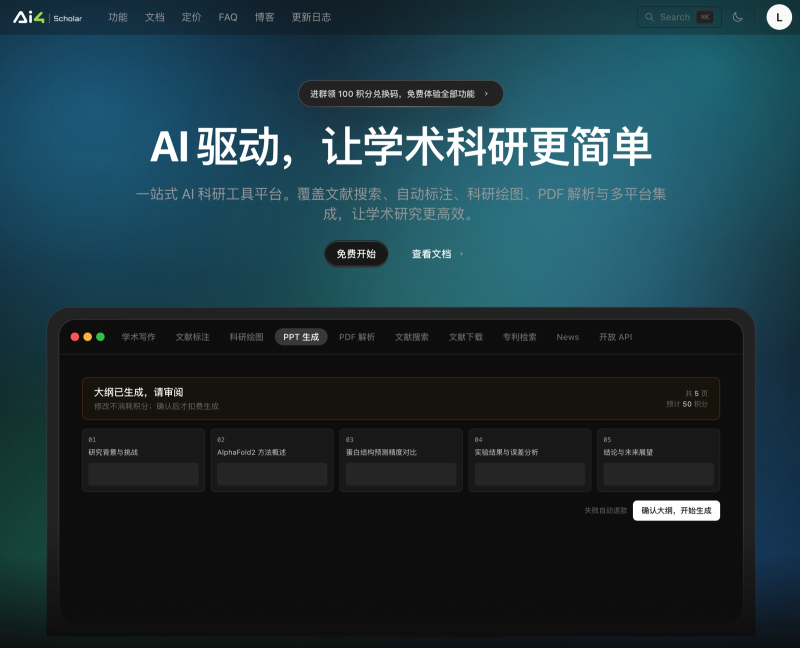
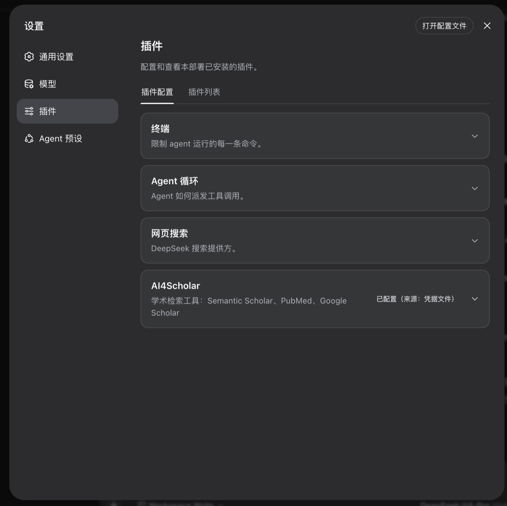
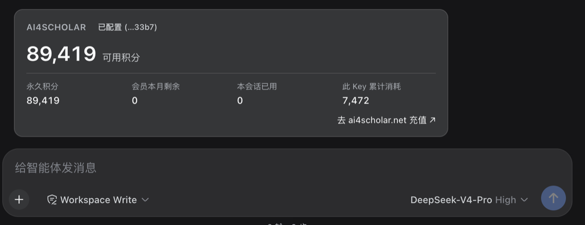

<p align="center"><a href="https://ai4scholar.net?src=dsh"></a></p>
<p align="center"><strong>dsh-ai4scholar</strong></p>

# AI4Scholar × DeepSeek Harness

[English](README.md) | 中文

[](https://www.npmjs.com/package/dsh-ai4scholar) [](https://github.com/literaf/dsh-ai4scholar/actions/workflows/ci.yml) [](https://github.com/topics/dsh-plugin) 

<p align="center"><a href="https://ai4scholar.net?src=dsh"></a></p>

为 [DeepSeek Harness](https://github.com/deepseek-ai/deepseek-harness)（`dsh`）提供学术文献能力的插件：43 个原生 agent 工具。由 [ai4scholar.net](https://ai4scholar.net?src=dsh) 提供数据服务。

## 斜杠命令：后面接自然语言

用斜杠选择能力，再直接说明条件，无需记忆参数名。未指定的来源和条数沿用插件设置。

| 命令 | 用途 |
|---|---|
| `/ai4s` | 密钥状态、余额、默认来源和条数、功能索引 |
| `/ai4s-search` | 统一论文检索，可用自然语言临时指定多个来源并去重 |
| `/ai4s-google` | Google Scholar 论文检索 |
| `/ai4s-semantic` | Semantic Scholar 检索、批量收集和全文片段 |
| `/ai4s-pubmed` | PubMed 生物医学论文 |
| `/ai4s-arxiv` | arXiv 预印本 |
| `/ai4s-chinese` | 中文期刊、学位论文和会议文献 |
| `/ai4s-biorxiv`、`/ai4s-medrxiv` | 按分类、时间浏览预印本 |
| `/ai4s-patents` | Google Patents 专利检索 |
| `/ai4s-author` | 找学者、看资料、论文列表和作者比较 |
| `/ai4s-paper` | 论文详情、标题匹配、批量详情、全文、PDF、被引、参考文献、相关推荐和引用格式 |
| `/ai4s-cite` | 为一段文字补充真实引用 |
| `/ai4s-draw` | 科研绘图、编辑、风格、合成、迭代、点评、SVG 和矢量化 |

```text
/ai4s-google 固态电池，2022 年以来的 10 篇
/ai4s-search 同时用 Google Scholar 和 Semantic Scholar 查固态电池，合并去重
/ai4s-author 查 Geoffrey Hinton 在 Google Scholar 上的资料和代表论文
/ai4s-paper 读刚才第三篇论文，重点解释研究方法
/ai4s-patents 找宁德时代近五年在中国申请的固态电池专利
```

空命令显示用法，不调用检索接口。研究命令作为当前对话的新请求排队，由已配置的模型理解自然语言并调用工具；结果进入对话历史，可以继续追问。执行前模型会简要说明理解出的来源和条件，遇到来源冲突或作者重名才澄清。来源命令在执行时校验来源，不修改全局设置。旧 `/ai4scholar` 与 `/ai4s` 都可查看状态。

当前 Harness 的论文、作者和专利结果卡片提供适用的后续操作。点击按钮会把带有准确标识的自然语言请求填入输入框，修改后发送即可；已有草稿会保留。PDF 和来源链接直接打开。旧版 Harness 没有对应卡片插槽时仍显示普通工具结果。

Google Scholar 论文保留原始论文 ID、被引和版本 ID；引用格式接口只接受原始论文 ID，不接受 DOI、URL 或作者页面的 citationId。作者查询默认 Semantic Scholar，明确指定 Google Scholar 时使用其作者接口；Google 返回的是可用论文列表，不能据此声称是全部成果，也不提供 h-index。bioRxiv/medRxiv 按分类与时间浏览，不是关键词全文检索。专利结果独立于论文统一检索。

| 家族 | 工具 | 计费 |
|---|---|---|
| **论文检索** | `search_papers`——默认只查 Semantic Scholar；通过 `sources` 按需选择 PubMed、arXiv、Google Scholar、中文文献。多平台结果按 DOI / arXiv id / PMID / 标题去重合并，同时命中的排前面 | 按所选平台计 |
| **Semantic Scholar**（2 亿+ 论文，全学科） | `search_semantic`、`search_semantic_bulk`、`search_semantic_snippets`（全文片段）、`search_semantic_paper_match`（标题→论文）、`get_semantic_paper_detail`、`get_semantic_paper_batch`、`get_semantic_citations`、`get_semantic_references`、`get_semantic_paper_authors`、`search_semantic_authors`、`get_semantic_author_detail`、`get_semantic_author_batch`、`get_semantic_author_papers`、`get_semantic_recommendations`、`get_semantic_recommendations_for_paper`、`download_semantic`、`read_semantic_paper` | 积分 |
| **PubMed**（生物医学） | `search_pubmed`、`get_pubmed_paper_detail`、`get_pubmed_paper_batch`、`get_pubmed_citations`、`get_pubmed_related` | 积分 |
| **中文文献**（期刊、学位论文、会议论文；题录与可用摘要） | `search_chinese` | 积分 |
| **Google Scholar**（论文、学者与引用格式） | `search_google_scholar`、`search_google_scholar_profiles`、`get_google_scholar_author`、`get_google_scholar_citation` | 积分 |
| **Google Patents**（专利） | `search_google_patents` | 积分 |
| **arXiv** | `search_arxiv`、`download_arxiv`、`read_arxiv_paper` | 免费 |
| **bioRxiv / medRxiv** | `search_biorxiv`、`search_medrxiv`、`download_biorxiv`、`download_medrxiv`、`read_biorxiv_paper`、`read_medrxiv_paper` | 免费 |
| **任意 DOI** | `download_by_doi`、`read_by_doi`（开放获取随处可用；付费期刊需校园网/机构权限） | 免费 |
| **写作与绘图** | `auto_cite`（自动插入真实引用 + 参考文献 + BibTeX）、`sci_draw`（生成 / 编辑 / 风格 / 合成 / 点评 / SVG / 矢量化科研图） | 积分 |
| **账户** | `get_ai4scholar_credits`，以及斜杠命令 `/ai4scholar` | 免费 |

**优先单平台检索。** 出厂设置下，不传 `sources`（或传 `[]`）时只查 Semantic Scholar；在插件页面修改默认平台后，同样的调用会按你的设置同时查询所选平台。生物医学或临床主题可按需选择 `sources: ["pubmed"]`。明确要求扩大覆盖面，或单平台结果不足时，再指定多个来源，例如 `["semantic-scholar", "pubmed"]`。各收费 API 请求的积分会累加；Google Scholar 按页计费，arXiv 免费。如果配置的默认平台全部被关闭，则按 Semantic Scholar、PubMed、arXiv、Google Scholar、中文文献的顺序，选择第一个已开启的平台。

所有论文列表类工具返回统一的结构——标题、作者、年份、期刊/会议、被引数、DOI/PMID/arXiv 等标识、链接、开放获取 PDF、摘要——模型（以及 Code Mode 程序）可以跨平台链式调用而无需特判。结果在 dsh Web UI 中渲染为引用卡片；全文类工具按片段返回（`offset` / `max_chars`），40 页的论文不会一次冲爆上下文。

**积分看得见。** 对话里每张计费工具卡片的标题都带本次消耗（`Semantic Scholar: protein folding · 10 credits · 4,990 left`）；模型看到的结果末尾有 `AI4Scholar credits — this call: 10 · this session: 40 · remaining: 4,960`（来自 API 的 `X-Credits-*` 响应头），并且提示词要求模型在用了计费工具的回合结尾用一句话汇报本轮消耗与余额；`/ai4scholar` 渲染成余额卡片（可用积分、明细、会员、Key 状态、本会话消耗），`get_ai4scholar_credits` 给模型同样的数字。免费源（arXiv、bioRxiv/medRxiv、DOI）不带积分行。

**中文文献。** `search_chinese` 支持中文关键词、文献类型（期刊／学位论文／会议论文）、年份筛选、排序和分页，也可以在 `search_papers` 中通过 `sources: ["chinese"]` 使用；出厂默认不勾选。中英文联合检索可传入 `query: "bird migration"`、`chinese_query: "鸟类迁徙"`、`sources: ["semantic-scholar", "chinese"]`。各来源按共同 DOI 和规范化标题去重；较短的中文标题还需年份和第一作者相同，DOI 不同的记录不会仅凭标题合并。中英文标题不同又没有共同标识时，可能仍保留两条。中文文献目前返回题录和可用摘要，不提供全文下载。

## 截图

| API Key 卡片（旧版设置界面） | `/ai4scholar` 余额卡 |
|---|---|
|  |  |

## 安装

**快速开始**（macOS / Linux；Windows 用 PowerShell 同理）：

```sh
# 0. 前置：Node.js ≥ 22.19（或 ≥ 24）和 pnpm（dsh 用 pnpm 管理插件）
node -v
npm i -g pnpm                     # 已有可跳过

# 1. 安装 DeepSeek Harness
npm i -g @deepseek-ai/dsh
dsh --version

# 2. 安装本插件（装进 web profile；命令行一次性任务用 --profile headless）
dsh plugin --profile web add dsh-ai4scholar

# 3. 启动
dsh web                           # 打印 http://127.0.0.1:3080
```

然后在网页里配置一次：

1. **设置 → 模型**：填 DeepSeek API Key（[platform.deepseek.com](https://platform.deepseek.com) 获取）。
2. **插件 → 已安装 → dsh-ai4scholar**（也可以打开 **设置 → AI4Scholar**）：粘贴 AI4Scholar API Key（[ai4scholar.net](https://ai4scholar.net?src=dsh) 获取），点 **保存**。卡片会把它存进 dsh 的凭据存储（`$DSH_HOME/.credentials.yaml`，权限 0600，和模型页保存 DeepSeek Key 是同一个地方），立刻测试（`✓ Key 有效 · 可用积分 89,419`），下一次工具调用即生效，无需重启；「刷新」可随时再测。已保存的密钥默认隐藏，右侧显示「密钥已配置」；点击眼睛可显示或隐藏。收起、离开页面或切换到其他窗口后会清除已显示的明文。

新版 DSH Desktop 在左侧 **插件 → 已安装** 中点击 **dsh-ai4scholar**，详情页就会直接显示 Key 表单。**设置 → 内置插件** 现在是宿主清单，不再承载这个表单。旧版 Harness 仍保留原来的 **设置 → 插件 → AI4Scholar** 卡片。已保存的 Key 继续有效，各入口使用同一个凭据引用。

选一个工作区目录就可以直接提问了。升级：`dsh plugin --profile web add dsh-ai4scholar@latest`，然后重启 `dsh web`。

更喜欢文件或 CI 方式？插件解析的是凭据引用 `AI4SCHOLAR_API_KEY`，以下途径同样有效（优先级从高到低）：启动 dsh 的 shell 里 `export AI4SCHOLAR_API_KEY=…` · `$DSH_HOME/.credentials.yaml` 中一行 · 项目目录或 `$DSH_HOME` 下的 `.env` 中一行。卡片会显示当前 Key 来自哪一层；来自环境变量时卡片变为只读。headless 没有设置页，请用其中一种。

每次发布后会自动触发 npmmirror 同步，国内默认源一分钟内也能装到新版本。

不启动也能验证配置层：`dsh --profile web --dump-config` 会打印出 `# == dsh-ai4scholar` 一节。

然后直接对话：

> 帮我找 2023 年以来 CRISPR 碱基编辑治疗镰状细胞病的论文，比较它们的递送方式。

> 在 PubMed 上按日期搜索 2022 年后 GLP-1 受体激动剂与心血管结局的研究。

> "Attention Is All You Need" 这篇论文的 DOI 和被引数是多少？

## 配置

### 在插件页面里改

打开 **插件 → dsh-ai4scholar**（或 **设置 → AI4Scholar**，两处改的是同一份配置），API Key 下面可以改：

- **检索设置**：勾选模型没指定时 search_papers 查的平台（默认只查 Semantic Scholar），并给每个平台设返回条数。Semantic Scholar、PubMed、中文文献每次最多 100 条、各计费一次；arXiv 每次最多 100 条且免费。Google Scholar 每次返回 1–10 条、计 1 积分，模型需要更多时保持相同条数并用 nextOffset 翻页。所有来源都能通过独立检索工具继续翻页；收费来源每多请求一页都会计费。这里的条数也是独立检索工具的默认条数。
- **结果内容**：提供给模型的摘要长度（0–5000 字符，默认 600）、read_* 每次读取的全文长度（2,000–200,000，默认 60,000）、是否在结果里显示积分。
- **引用与配图**：auto_cite 的参考文献格式（默认 IEEE）和是否排除预印本；sci_draw 的配图模型（默认 Flash 3.1）和分辨率（默认 2K）。

模型在单次调用里仍可以自己指定这些参数。点 **保存** 会把改动写进 profile 的 `cordis.patch.yml`，插件随即按新设置重新加载，下一次工具调用和新对话都会生效。**恢复默认** 会删掉这些覆盖。这个页面需要 DeepSeek Harness 0.2.1 或更高版本；旧版本会提示你改配置文件。

### 在 profile 配置文件里改

组合包只插入一行（`id: ai4scholar`），默认值如下。在你 profile 的 `cordis.patch.yml` 中覆盖（patch 会整体替换 `config`，请把要保留的键一起写上）。DeepSeek Harness 桌面版在 macOS 上的文件是 `~/.dsh/profiles/desktop/cordis.patch.yml`；命令行版是 `$DSH_HOME/profiles/<profile>/cordis.patch.yml`：

```yaml
- id: ai4scholar
  config:
    apiKeyEnv: AI4SCHOLAR_API_KEY   # 凭据引用名；Key 本身永远不写进配置
    baseUrl: https://ai4scholar.net
    # 工具家族开关
    semanticScholar: true
    pubmed: true
    googleScholar: true
    googlePatents: true              # search_google_patents
    chineseLiterature: true          # search_chinese
    arxiv: true
    biorxiv: true                    # bioRxiv + medRxiv
    doi: true
    fullText: true                   # read_* 全文工具（下载 PDF + 抽取文本）
    autoCite: true
    sciDraw: true
    creditsTool: true                # get_ai4scholar_credits
    command: true                    # /ai4s、/ai4scholar 和 /ai4s-* 命令
    balanceRoute: true               # 设置卡片测试 Key 用的 GET /ai4scholar/balance 路由
    showCredits: true                # 计费结果末尾的积分行（插件页面可改）
    promptGuidance: true             # 注入一小段 system prompt 说明何时用哪个工具
    promptOrder: 150
    # search_papers 默认检索的平台（插件页面可改），可选
    # semantic-scholar、pubmed、arxiv、google-scholar、chinese
    searchSources: [semantic-scholar]
    # 每个平台的返回条数（插件页面可改），没设的平台用 defaultMaxResults
    resultsPerSource: {}             # 例如 { semantic-scholar: 100, google-scholar: 10 }
    citeStyle: ieee                  # auto_cite：ieee | apa | vancouver | nature | numbered（插件页面可改）
    citeExcludePreprints: false      # auto_cite（插件页面可改）
    drawModel: flash31               # sci_draw：flash | flash31 | pro | gptimage（插件页面可改）
    drawImageSize: 2K                # sci_draw：1K | 2K | 4K（插件页面可改）
    # 条数与长度
    defaultMaxResults: 10            # 各平台共用的备用条数（配置文件中修改）
    maxResultsCap: 100               # 单次调用上限；各平台另有自己的上限
    abstractMaxChars: 600            # 每篇论文展示给模型的摘要字符数；0 表示不展示（插件页面可改）
    readMaxChars: 60000              # 全文每片字符数（插件页面可改）
    # 超时与重试
    requestTimeoutMs: 30000          # 单次 HTTP 请求
    pdfTimeoutMs: 120000             # 单次 PDF 下载
    generationTimeoutMs: 300000      # auto_cite / sci_draw
    maxRetries: 3                    # 429 / 网络错误的尝试次数
    retryBackoffMs: 2000             # 退避基数，逐次翻倍
    toolTimeoutMs: 180000            # dsh 强制执行的单次工具调用预算
```

API Key 通过 `ctx.credentials` **按调用**解析：新存入或轮换的 Key 在下一次工具调用即生效，无需重启。若组合中没有凭据服务（自定义组装），插件回退读取 `process.env[apiKeyEnv]`。

设置卡片固定编辑 `AI4SCHOLAR_API_KEY`（浏览器半侧拿不到行配置）；覆盖了 `apiKeyEnv` 的部署请改用环境变量或凭据文件管理该引用。会话累计消耗是进程内计数（dsh 重启后归零）；余额本身始终来自 API。

## 与 dsh 的契合方式

- 一个包、两个半侧：Node 半侧注册工具；浏览器半侧（`exports["./client"]`，由 `dsh.client` 声明）通过 `plugins.bundle.config` / `plugins.row.config` 贡献原生插件详情页，通过 `settings.section` 贡献独立设置页，并兼容旧版 `settings.plugin.item` 卡片，通过凭据 API 保存密钥。主动点击显示时，使用宿主认证且仅允许 owner 访问的 `POST /api/ai4scholar/key/reveal` 接口，响应禁止缓存；该接口不是模型工具，也不会把密钥加入模型上下文。没有这一受保护通道的旧宿主不支持显示已保存的密钥。
- 工具通过 `defineTool` 注册到 `ctx.tools`：参数有类型且经 schema 校验；每次调用返回规范 JSON 值（`{ source, query, total, papers[], truncated, nextOffset? }`）；给模型看的是 Markdown 渲染；给 Web UI 的是 `web` 结果卡片（结构化来源）。
- 一段 `tool:ai4scholar` system prompt 告诉模型何时用哪个平台、如何用 DOI/链接引用。
- 一切皆 effect：卸载插件（或修改其配置触发 HMR）会同时撤销全部工具和提示词片段。
- 除工具结果外不新增任何模型可见输入，会话仍可从日志完整回放。

## 开发

```sh
pnpm install
pnpm test          # 先构建 lib/（Node 半侧 tsc，浏览器 bundle tsdown），再跑：单元测试、
                   # 针对真实 ToolRuntime 的冒烟测试、以及在 jsdom 里按 dsh 模块宿主契约加载
                   # 构建好的客户端 bundle 并驱动卡片的测试
pnpm typecheck

# 不发布也能在 dsh profile 中试用：
dsh plugin --profile web add /absolute/path/to/dsh-ai4scholar
```

也支持 `dsh plugin add github:<you>/dsh-ai4scholar`：`prepare` 脚本会从源码构建 `lib/`，pnpm 会要求你在 profile 的 `pnpm-workspace.yaml` 中通过 `allowBuilds` 授权一次。

## 说明

- `download_by_doi` / `read_by_doi` 经 doi.org 解析并尝试已知出版商的 PDF 路径（Elsevier、Springer/Nature、Wiley、T&F、MDPI、IEEE、ACM、ACS、RSC、PLOS、Frontiers、bioRxiv/medRxiv、arXiv）。付费文章只有当 dsh 运行在有机构权限的网络上才能下载；失败时会给出落地页链接，方便用户手动获取。
- 全文抽取使用进程内的 `pdf-parse`（pdf.js）；扫描版/纯图片 PDF 会明确报错而不是返回空文本。
- 同一套工具已提供 [OpenClaw](https://github.com/literaf/ai4scholar-plugin-openclaw)、[Codex](https://github.com/literaf/ai4scholar-plugin-codex) 和 [Hermes](https://github.com/literaf/ai4scholar-plugin-hermes) 版本。

## 许可证

MIT
